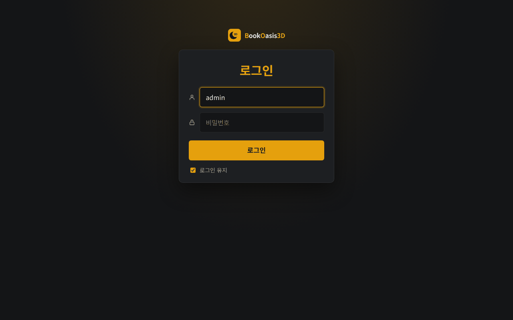
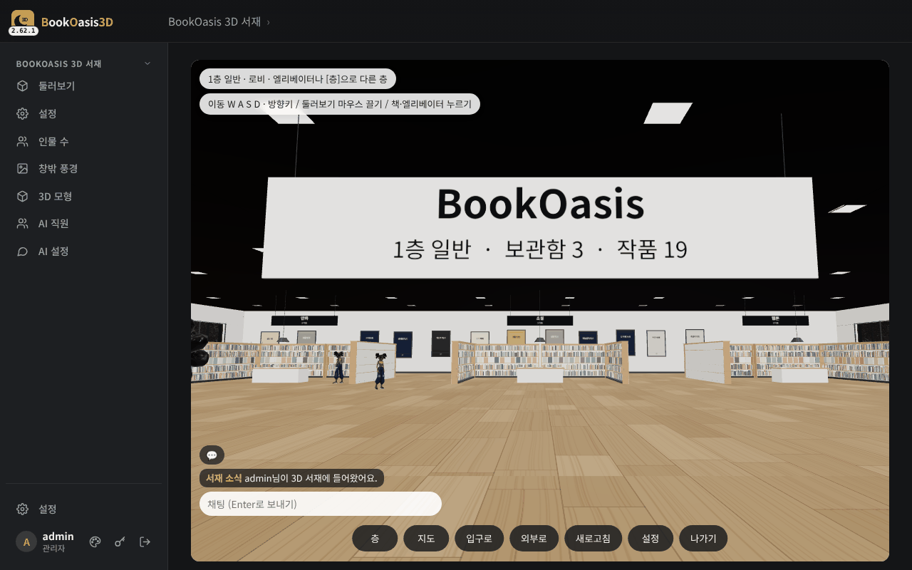
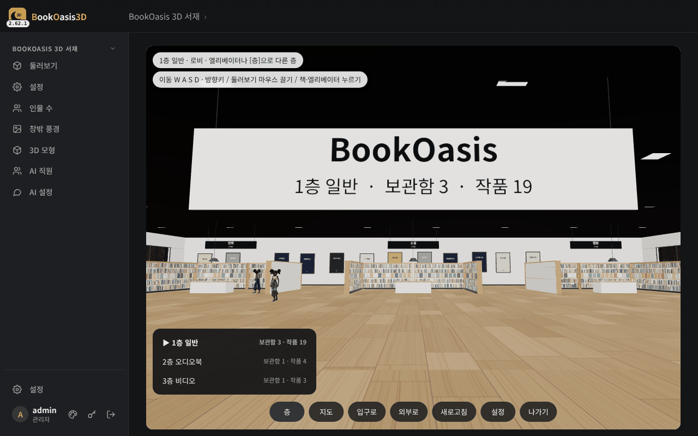
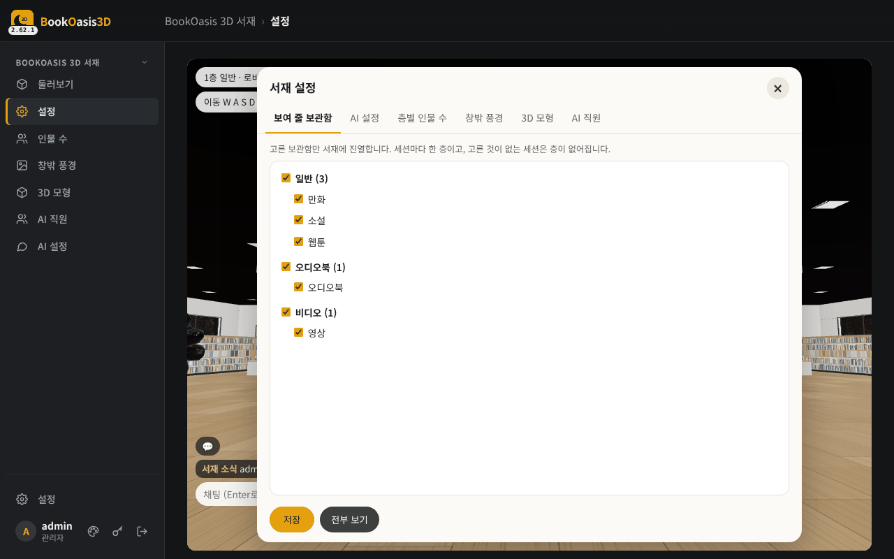
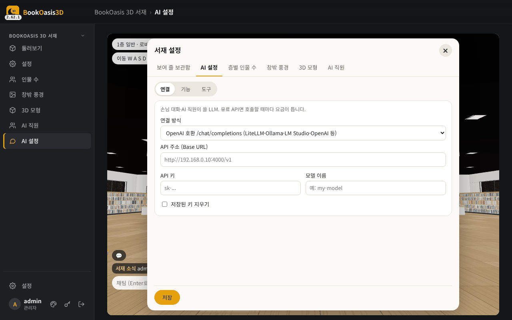
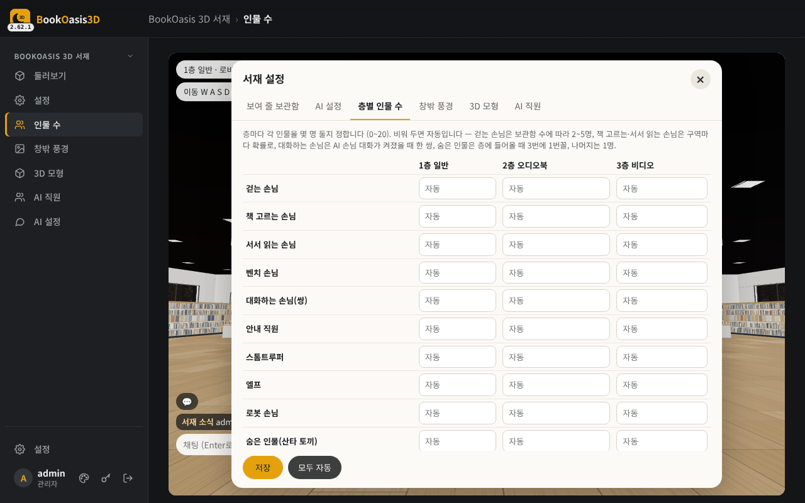
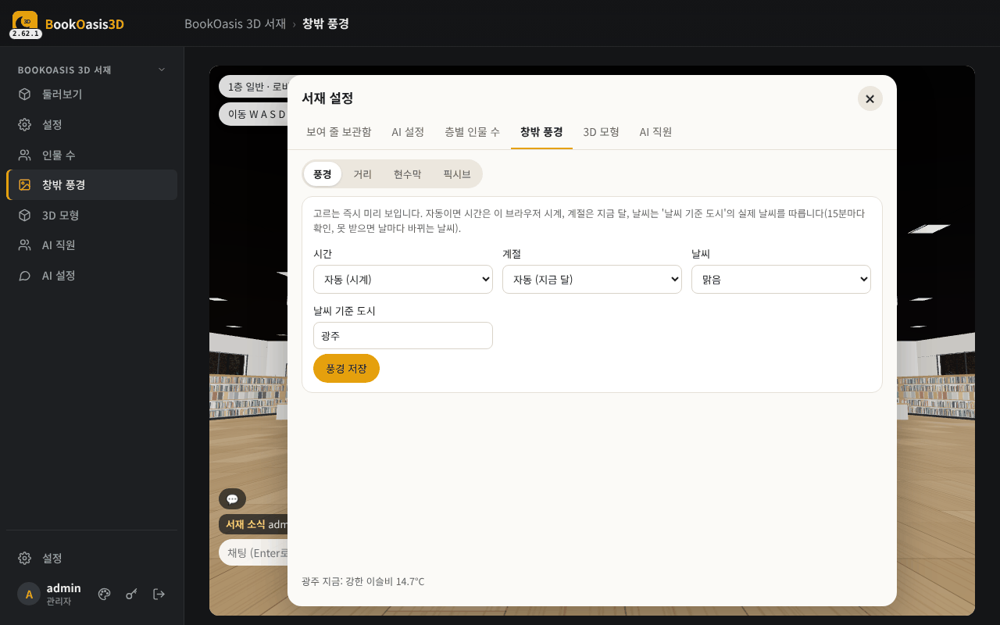
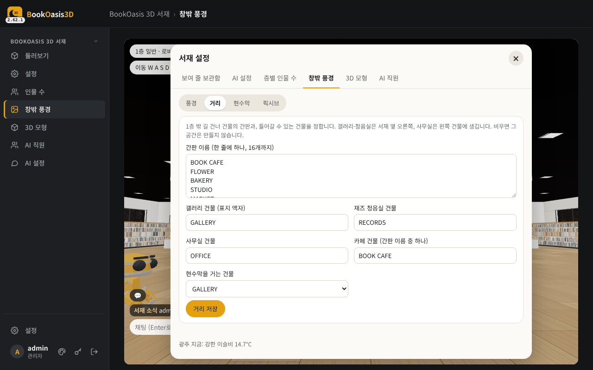
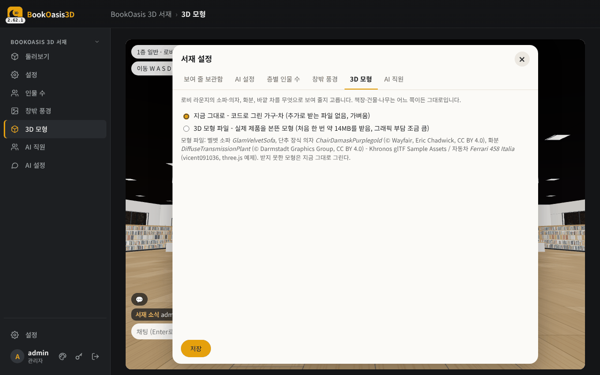
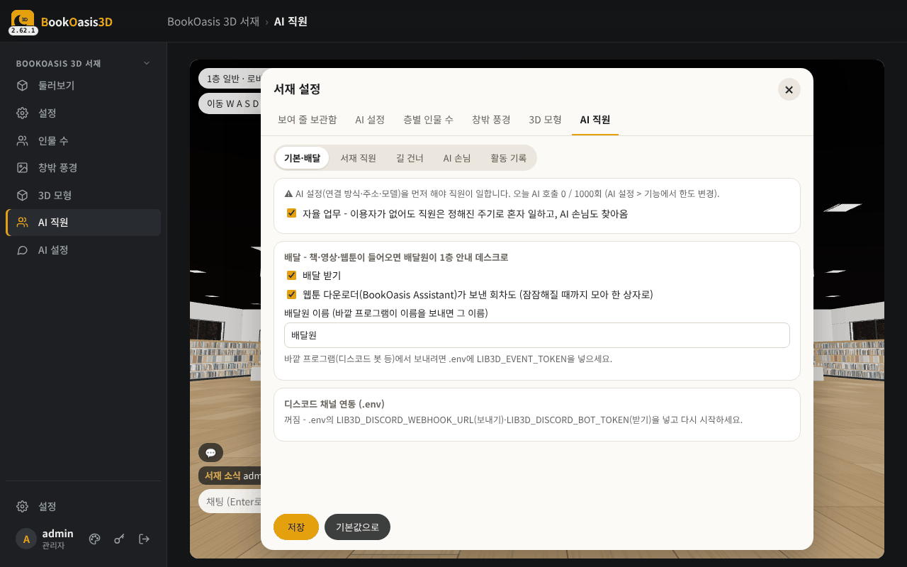

# BookOasis 3D 서재 설정 가이드

> 설치를 마치고 처음 로그인한 다음부터 보는 문서입니다. 설치는 [install-venv.md](install-venv.md)(권장) 또는 [install-docker.md](install-docker.md).
> 코너별 자세한 설명·`.env` 전체 목록·문제 해결은 [guide.md](guide.md).

## 차례
1. [처음 로그인](#1-처음-로그인)
2. [1층 로비와 움직이기](#2-1층-로비와-움직이기)
3. [서재 설정 창](#3-서재-설정-창)
   - [보여 줄 보관함](#3-1-보여-줄-보관함-가장-먼저) · [AI 설정](#3-2-ai-설정-선택) · [층별 인물 수](#3-3-층별-인물-수) · [창밖 풍경](#3-4-창밖-풍경) · [3D 모형](#3-5-3d-모형) · [AI 직원](#3-6-ai-직원)
4. [계정 추가 (관람자)](#4-계정-추가-관람자)
5. [선택 기능 켜기 (.env)](#5-선택-기능-켜기-env)
6. [체크리스트](#6-체크리스트)

---

## 1. 처음 로그인

`.env`에 `WEB_USER`/`WEB_PASSWORD`를 넣었으면 그 계정으로 로그인합니다. **로그인 유지**를 켜 두면 다시 묻지 않습니다.

사용자가 하나도 없고 `127.0.0.1`로 열었을 때는 **관리자 계정 만들기** 화면이 먼저 나옵니다.

---

## 2. 1층 로비와 움직이기

로그인하면 1층 로비가 열립니다. 가운데 간판에 층 이름·보관함 수·작품 수가 보이고, 보관함마다 서가 구역(위에 보관함 이름 표지)이 놓입니다.
표지는 가까운 책부터 BookOasis에서 받아 붙습니다(처음에는 색 상자로 보이다가 바뀜).

| | PC | 아이패드·폰 (터치) |
|---|---|---|
| 걷기 | W A S D · ↑↓ (Shift 누른 채 달리기) | 오른쪽 아래 방향 버튼 |
| 둘러보기 | ←→ 돌기, 마우스 끌기 | 화면 끌기 |
| 고르기 | 책·엘리베이터·의자 클릭 | 짧게 누르기 |

아래 단추:

| 단추 | 하는 일 |
|---|---|
| **층** | 다른 층으로 (세션마다 한 층: 일반·성인·오디오북·비디오, YMPlayer를 연결하면 맨 위 영화관) |
| **지도** | 구역 목록에서 눌러 그 서가 앞으로 |
| **입구로** | 처음 자리로 |
| **외부로** | 1층 밖 강 위 다리로 (거리·갤러리·재즈 청음실·캠핑장) |
| **새로고침** | 보관함·작품을 다시 읽기 |
| **설정** | 서재 설정 창 (관리자) |
| **나가기** | 소리·움직임을 멈추고 나가기 |

**책을 누르면** 작품 카드: **여기서 읽기**(만화·웹툰·EPUB·PDF) / **여기서 듣기**(오디오북) / **여기서 보기**(영상) /
BookOasis 뷰어로 읽기 / 작품 상세. "여기서 …"가 안 되면 책 파일이 이 서버에서 BookOasis와 같은 경로로 보이지 않는 것입니다(설치 가이드 참고).

왼쪽 아래 **채팅**: 같은 층의 사람에게 보내고 말풍선으로 보입니다. AI 직원을 켜면 `@사서 만화 추천해 줘`처럼 부를 수 있습니다.

---

## 3. 서재 설정 창

왼쪽 메뉴(설정 · 인물 수 · 창밖 풍경 · 3D 모형 · AI 직원 · AI 설정) 또는 아래 [설정]을 누르면 **서재 설정** 창이 열립니다.
위쪽 탭으로 오가고, 탭마다 **[저장]**하면 모든 사람에게 바로 적용됩니다. 닫기는 ✕ 또는 Esc.

### 3-1. 보여 줄 보관함 (가장 먼저)

BookOasis 세션(일반·성인·오디오북·비디오)별로 보관함이 나옵니다. **서재에 놓을 보관함을 체크**하고 [저장].
고른 보관함이 하나도 없는 세션은 층이 생기지 않습니다. [전부 보기]는 모두 체크.

> 보관함마다 최근 작품 몇 권을 책장에 놓을지는 `.env`의 `LIB3D_PER_LIBRARY`(기본 300, 많으면 무거움).

### 3-2. AI 설정 (선택)

AI 직원(사서·도슨트 등)과 AI 손님 대화를 쓸 때만. 하위 탭 **연결 · 기능 · 도구**.

| 칸 | 넣을 것 |
|---|---|
| 연결 방식 | **OpenAI 호환** (LiteLLM·Ollama·LM Studio·OpenAI - 추가 설치 없음) 또는 **Claude API** |
| API 주소 (Base URL) | OpenAI 호환일 때: 예 `http://192.168.0.10:4000/v1` (끝이 `/v1`까지) |
| API 키 | 게이트웨이·서비스의 키 (Claude API는 비우면 `ANTHROPIC_API_KEY` 환경변수) |
| 모델 이름 | 게이트웨이에 등록된 이름 그대로 |

**기능** 탭에서 손님 대화·AI 직원 응대를 켜고 하루 호출 한도(기본 1000)를 정합니다. **도구** 탭에서 BookOasis MCP를 연결하면
AI 직원이 서재를 검색해 답합니다([MCP 연결 시험]으로 확인). 저장하면 `.env`의 `LIB3D_AI_*`에 들어갑니다.

> 유료 API면 호출마다 요금이 듭니다. 처음에는 한도를 낮게 두세요.

### 3-3. 층별 인물 수

층마다 손님·직원·스톰트루퍼·엘프·로봇 손님 수(0~20). 비우면 "자동"(층 크기에 맞춤). 화면이 버벅이면 줄이세요. [모두 자동]으로 되돌립니다.

### 3-4. 창밖 풍경

하위 탭 **풍경 · 거리 · 현수막 · 픽시브**.

- **풍경**: 시간(자동=시계, 낮·노을·밤) · 계절(자동=지금 달) · 날씨(맑음·흐림·비·눈·**자동**).
  날씨가 '자동'이면 **날씨 기준 도시**(기본 광주)의 실제 날씨가 창밖에 보입니다(15분마다 확인).
- **거리**: 1층 밖 길 건너 간판 이름(한 줄에 하나)과 갤러리·재즈 청음실·사무실·카페·현수막 건물. 비우면 그 공간이 없습니다.
  공개 기본값은 중립 이름이니 자기 가게·회사 이름으로 바꿔 쓰세요.

- **현수막**: 없음 / 그림 주소 / 보관함 표지(정한 간격마다 무작위).
- **픽시브**: 길 건너 픽시브 랭킹 전시관(선택, 기본 꺼짐 - [guide.md 6-11](guide.md#6-11-픽시브-랭킹-전시관-선택-기본-꺼짐)).

### 3-5. 3D 모형

라운지 소파·의자·화분·차를 **지금 그대로**(코드로 그린 가구, 가벼움 - 권장) 또는 **3D 모형 파일**(처음 한 번 약 14MB, 그래픽 부담 큼).

### 3-6. AI 직원

하위 탭 **기본·배달 · 서재 직원 · 길 건너 · AI 손님 · 활동 기록**.

- **기본·배달**: 자율 업무(이용자가 없어도 직원이 정해진 주기로 일함) 켜기, **배달 받기**
  (BookOasis Assistant 웹툰 다운로더·디스코드 봇이 보낸 책·영상·웹툰을 배달원이 1층 안내 데스크로 - `.env`의 `LIB3D_EVENT_TOKEN` 필요).
- **서재 직원 / 길 건너**: 사람마다 카드를 펼쳐 이름·직업·부르는 말·성격·업무(주기·지시문)를 바꾸고 [지금 실행]으로 시험.
- **AI 손님**: AI 손님 켜기와 수. **활동 기록**: 직원·손님이 한 일. [기본값으로]로 처음 설정.

AI 직원은 3-2의 AI 연결이 되어 있어야 움직입니다.

---

## 4. 계정 추가 (관람자)

왼쪽 맨 아래 ⚙️ **설정 > 사용자**에서 계정을 추가합니다.

| 권한 | 할 수 있는 것 |
|---|---|
| **관리자** | 모든 설정 |
| **관람자** | 둘러보기·읽기·듣기·보기·함께 보기·채팅 (설정 메뉴 없음) |
| 관람자 + **성인 층 허용** | 위 + 2층 성인 서재 |

관람자로 들어오면 먼저 "이름을 적어 주세요" 창이 뜨고, 그 이름이 머리 위 이름표·채팅에 보입니다.
같은 손님 계정(예: guest)을 여러 사람이 동시에 써도 창마다 따로 보입니다.

---

## 5. 선택 기능 켜기 (.env)

화면이 아니라 `.env`에서 켜는 것들입니다(바꾼 뒤 서비스 재시작).

| 기능 | `.env` | 자세히 |
|---|---|---|
| 맨 위 **영화관** (YMPlayer IPTV·텔레그램 상영) | `LIB3D_YMPLAYER_URL`, `LIB3D_YMPLAYER_INTERNAL`, `LIB3D_YMPLAYER_USER`/`PASSWORD` (YMPlayer에 서재용 일반 사용자 계정) | [guide.md 3-4](guide.md#3-4-영화관-ymplayer) |
| **배달** (웹툰 다운로더 → 안내 데스크) | `LIB3D_EVENT_TOKEN` (BookOasis Assistant `.env`에도 같은 값 + `LIB3D_URL`) | [guide.md 6-8](guide.md#6-8-배달과-바깥-ai-전화) |
| **디스코드** 채널 연동 | `LIB3D_DISCORD_WEBHOOK_URL`(보내기), `LIB3D_DISCORD_BOT_TOKEN`·`LIB3D_DISCORD_CHANNEL_ID`(받기) | [guide.md 6-9](guide.md#6-9-디스코드-채널-연동-선택-기본-꺼짐) |
| **서재 소식** (Plex·YMPlayer 재생 알림) | `LIB3D_ACTIVITY`, `LIB3D_PLEX_URL`/`TOKEN`, `LIB3D_YMPLAYER_MCP_TOKEN` | [guide.md 6-10](guide.md#6-10-서재-소식-접속읽기재생-알림) |
| 브런치 낭독 **Edge 음성** | `venv/bin/pip install edge-tts` (도커 이미지는 포함) | [guide.md 3-3](guide.md#3-3-브런치-낭독-edge-음성-선택) |
| 오락실 끄기 | `MINI_ENABLED=false` | |

---

## 6. 체크리스트

1. [ ] 로그인하면 1층 로비가 뜬다 (안 뜨면 `app.py --check`)
2. [ ] 서가에 표지가 붙는다 (`BOOKOASIS_URL`)
3. [ ] 책을 눌러 [여기서 읽기]가 열린다 (책 파일 경로)
4. [ ] 설정 > 보여 줄 보관함에서 보관함을 골랐다
5. [ ] (선택) AI 설정 → [MCP 연결 시험] → AI 직원이 채팅에 답한다
6. [ ] (선택) 관람자 계정을 만들고 다른 기기에서 들어가 본다

막히면 [guide.md의 문제 해결](guide.md#10-문제-해결)을 보세요.
